<p align="center">
  
</p>

<p align="center"><a href="https://zummed.github.io/corbie/"><b>Read the manual</b></a></p>

<br>

<h2 align="center">Composable machines</h2>

<p align="center"></p>
<p align="center">Mix predictable workflows with dynamic agents.</p>

<br>

## A machine is YAML and scripts

The YAML says what runs.

```yaml
# title.yaml
flow: fetch-title
input: { url: string }

stages:
  get_title:
    job:
      script: ./fetch-title.js
      input: { url: "${input.url}" }
      allow: [net:example.com]

output: ${stages.get_title.output}
```

The script does the work, in JavaScript.

```js
// fetch-title.js
const http = require("http");
const html = require("html");

const page = http.get(input.url);
const doc = html.parse(page.body);
const titleElement = doc.find("title");

return {
  url: input.url,
  title: titleElement ? titleElement.text : "No title found"
};
```

<br>

## An AI can write it for you

Connect your assistant once.

```sh
claude mcp add corbie -- corbie mcp --allow test
```

Then ask for what you want "using Corbie". It reads the manual, writes the machine and runs it.

<br>

## Scripts are fenced in

A script reaches only what its machine allows. Anything else is refused, with the line that would allow it.

```
client/20261012T210153.624Z-d2729e69f1  failed (denied)  flow fetch-title  step 2
  refused: net:example.com:443
  by: the job "get_title" in the definition of "fetch-title"
  fix: add the line net:example.com:443 to the allow list of the job "get_title" in the definition of "fetch-title"
```

<br>

## Where it runs

Corbie needs no server and no database. The same machine runs on one computer, on several, or as AWS Lambda functions.

<br>

## Getting Corbie

Corbie is one file.

```sh
curl -Lo corbie https://github.com/zummed/corbie/releases/latest/download/corbie-linux-amd64
chmod +x corbie
mv corbie ~/.local/bin/
```

Other builds are on the [latest release](https://github.com/zummed/corbie/releases/latest).

The manual is at [zummed.github.io/corbie](https://zummed.github.io/corbie/). `corbie manual web` serves the same pages on your computer.

<br>

## License

Copyright 2026 Paul Young. Licensed under the Apache License, Version 2.0: see `LICENSE` and `NOTICE`.

Contributions submitted to this repository are accepted under the same license (section 5 of the Apache License).

Corbie was written with Claude Code, designed and directed by Paul Young.
